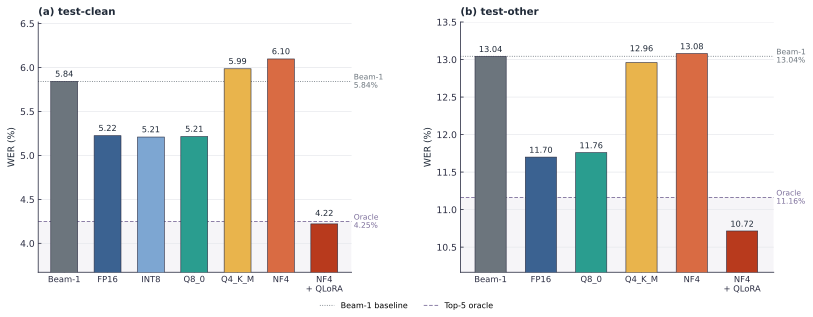
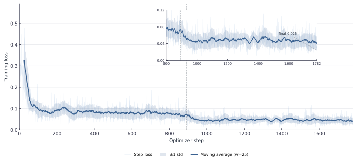
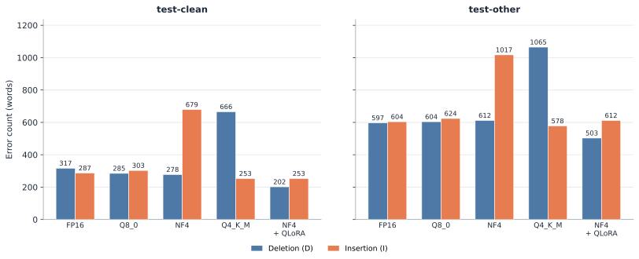
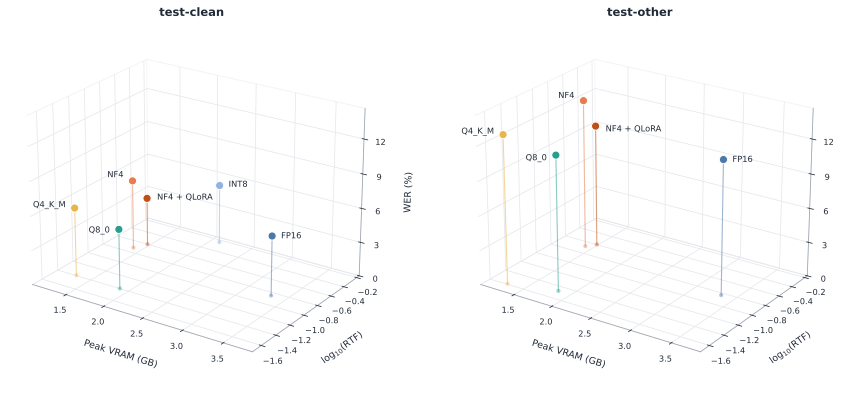

# 端侧低显存语音识别纠错：Qwen3-1.7B 级联 GER 的多精度量化与 QLoRA 适配研究

**摘要**　生成式纠错（Generative Error Correction, GER）把小型语言模型接入声学识别前端，可在不重训声学模型的前提下降低词错误率（WER），但其端侧部署受限于量化带来的精度退化与显存—延迟约束。本文在 LibriSpeech `test-clean` 与 `test-other` 上系统评测了 Qwen3-1.7B 在 5 种推理配置下的表现：HuggingFace + bitsandbytes 的 FP16 / INT8 / NF4，以及定制 llama.cpp 的 Q8_0 / Q4_K_M，并在此基础上以 NF4 QLoRA 做低秩适配。实验表明：（1）4-bit 量化存在显著精度悬崖，NF4 在干净集与噪声集分别比 FP16 高 0.88 与 1.38 个百分点；（2）两类 4-bit 后端的错误方向系统性相反——NF4 偏向插入（复读与加词），Q4_K_M 偏向删除（截断与粘连），且在两个数据集上对称复现；（3）llama.cpp Q8_0 是零样本条件下的帕累托最优，WER 与 INT8 持平而实时率（RTF）快 14.5 倍、显存少 224 MB；（4）NF4 QLoRA 仅以 1.5 GB 推理显存即在两个测试集上分别达到 4.22% 与 10.72% 的 WER，双双击穿声学 Top-5 候选的理论上界（4.25% / 11.16%）。全部结果统一采用 whisper-normalizer 1.0.1 评测口径。

**关键词**　语音识别；生成式纠错；量化；QLoRA；端侧推理；LibriSpeech

---

## 1. 引言

端侧语音识别长期受制于两个相互耦合的约束：声学模型的表征能力，与推理链路的显存和延迟预算。以 wav2vec2 为代表的纯 CTC 前端可以在数百兆显存内完成流式解码，但受限于单向上下文与有限的语言建模能力，在噪声条件下的错误率仍然可观。将小型语言模型（LLM）作为后置纠错器，读取声学前端给出的 N-best 候选并输出修正后的转写，是一种低成本、可插拔的增强路径——它不需要改动声学权重，也不需要成对音频—文本监督，只依赖预训练语言模型的先验知识。

然而，把 1.7B 级模型放到 6 GB 显存的家用 GPU 上，全精度推理（约 3.4 GB 峰值）几乎没有为其他组件留下空间。4-bit 量化是唯一现实的压缩手段，但它同时引入了两个新问题。

**第一，精度悬崖的方向性。** 既有工作报告 4-bit 量化会带来 WER 上升，却较少刻画上升的**构成**。我们的实验显示，NF4 与 Q4_K_M 虽然同为 4-bit，WER 退化幅度也相近，但错误类型截然相反：前者以插入为主，后者以删除为主。这一差异源于量化粒度与分组策略，直接影响下游能否用后处理缓解，因而具有独立的工程价值。

**第二，量化与适配的交互。** 若把低秩适配（LoRA）叠加在 4-bit 底座上（即 QLoRA），适配器能否在极低比特下恢复甚至超越全精度性能，目前缺少在统一评测口径下的端到端证据。尤其是：适配器能否突破声学候选集的**理论上界**（Top-5 Oracle）？若可以，说明语言模型在纠错之外还具备候选重组能力，这对级联架构的定位有实质影响。

本文的目标是在统一口径下回答上述两个问题，并给出可复现的端侧配置建议。贡献归纳为三点：

1. 在 LibriSpeech 双测试集上完成 1.7B 模型 5 种量化配置 + QLoRA 的全档评测，所有数字统一到 whisper-normalizer 1.0.1 口径；
2. 定量刻画 4-bit 量化的错误方向分化，并在干净集与噪声集上验证其对称性；
3. 在三维（显存 × 延迟 × 精度）空间中给出零样本帕累托前沿，并证明 QLoRA 可击穿 Top-5 Oracle 上界。

---

## 2. 系统架构与方法

### 2.1 级联 GER 总体流程

系统由三级构成：

```
音频 ──▶ wav2vec2-base-100h (CTC) ──▶ pyctcdecode beam search ──▶ Top-5 N-best
                                                                      │
                                                                      ▼
                                              Qwen3-1.7B（受控 GER 提示）──▶ 修正转写
                                                                      │
                                                                      ▼
                                                    EnglishTextNormalizer ──▶ WER / S-D-I
```

N-best 候选在离线阶段一次性导出并静态缓存（`outputs/nbest/*.jsonl`），每条样本记录参考文本、CTC 贪心解码结果与带对数概率的 Top-5 候选。这一设计把声学前端的成本与 LLM 评测解耦：量化档切换、LoRA 挂载、后处理调整都无需重跑声学模型。

### 2.2 声学前端

采用 `facebook/wav2vec2-base-100h`（约 95 M 参数，100 小时 LibriSpeech 预训练）配合 `pyctcdecode`，`beam_width=32`，导出 Top-5。为规避 CTC 的双重折叠问题，解码时手工执行标准折叠（blank 重置前一状态）并显式关闭 tokenizer 的 `group_tokens`，与 HuggingFace `batch_decode` 结果逐条对齐验证。

Top-5 Oracle 定义为：逐句在 5 个候选中选取句级 WER 最小的一个，再按语料级聚合。它刻画了"若后置模型具备完美候选选择能力"的性能上界，是判断纠错器是否具备**候选重组**能力的基准线。

### 2.3 确定性推理与提示约束

Qwen3 的思考模式（thinking mode）会在输出前生成推理链，既拖慢解码又污染 WER 统计。所有调用统一设置 `enable_thinking=False`，并在文本规范化层做防御性剥离（处理空思考块、未闭合标签等异常形态）。

解码采用贪心策略（`do_sample=False`、`temperature=0`），配合 `repetition_penalty=1.10` 抑制低比特量化诱发的死循环。生成长度按输入动态设限：`max_new_tokens = int(top1_words × 2.0) + 24`。

提示模板锁定为 `plain` 形式（候选文本直接拼接），而非带编号的列表。早期实验显示，编号列表会诱导模型逐条复述候选，NF4 档 WER 因此恶化到 24.4%；改为 plain 模板并强化系统提示后恢复正常。

输出解析由 `extract_answer()` 承担，采用三层防护：词级近似重复检测（用 `SequenceMatcher` 枚举首段长度，短单元阈值 0.95、长单元 0.85，避免误截正常排比句）→ 多行取末行 → 剥离行首编号。

### 2.4 双后端量化机制

**HuggingFace + bitsandbytes**（`hf_bnb`）覆盖三档：

| 档位 | 机制 |
|---|---|
| FP16 | 半精度权重，无量化 |
| INT8 | `load_in_8bit`，LLM.int8() 混合精度分解 |
| NF4 | 4-bit NormalFloat + 双重量化，计算时反量化为 FP16 |

**定制 llama.cpp**（`llamacpp`）覆盖 GGUF 两档：Q8_0（8-bit 分组量化）与 Q4_K_M（4-bit K-quant，混合分组尺度）。后端以 server 模式接入，通过 `/completion` 端点获取生成文本与精确的 token 计数、TTFT 与生成耗时；显存采用三级口径（启动前基线注入 > 进程级 compute-apps > 差分兜底），保证含权重的全量占用可测。

### 2.5 QLoRA 低秩适配

在 NF4 底座上挂载 LoRA：秩 `r=16`、`alpha=32`、`dropout=0.05`，覆盖全部 7 个线性投影模块（`q/k/v/o/gate/up/down`）。可训练参数 17.43 M，占总量 1.003%。训练采用 `prepare_model_for_kbit_training` + 梯度检查点 + `paged_adamw_8bit`，目标序列为 `ref.lower() + <|im_end|>`（刻意**不**经过 WER 规范化，否则撇号与数字改写会与推理输出分布错配），仅对 assistant 段计算损失。

训练模板与推理模板的一致性由脚本硬校验：读取 adapter 目录下的 `qlora_summary.json`，若 `template` 字段与推理参数不符则直接报错。这一约束排除了"训练用 plain、推理用 numbered"这类静默失配。

### 2.6 统一评测口径

WER 与 S/D/I 由 `jiwer` 在语料级计算，参考文本与假设文本同时经过 `EnglishTextNormalizer`。

本仓库统一使用 **whisper-normalizer 1.0.1**。该版本相对 0.1.x 的关键差异在于所有格处理：0.1.15 把 `shelley's` 展开为 `shelley is`，1.0.1 输出 `shelleys`。这一差异影响约 7% 的假设文本，导致整体 WER 相差约 0.10 个百分点。两版本混用会使跨环境数字不可比，因此本文所有结果——包括在云端与本地分别产生的行——均在 1.0.1 口径下重算。

---

## 3. 实验设置

### 3.1 数据集

| 划分 | 样本数 | 用途 |
|---|---:|---|
| `test-clean` | 2620 | 朗读语音测试集 |
| `test-other` | 2939 | 口音/噪声条件更复杂的测试集 |
| `train-clean-100` | 28539 | QLoRA 训练集 |

声学 N-best 在 `test-clean` 与 `test-other` 上全量导出；`train-clean-100` 仅用于训练适配器，训练与测试无重叠。

### 3.2 硬件环境

| 环境 | 硬件 | 可用显存 | 承担任务 |
|---|---|---|---|
| 本地 | RTX 3060 Laptop（WSL2） | 6 GB，安全上限 4.5 GB | 1.7B 全档推理、llama.cpp 联调 |
| 云端 | 魔搭 A10 | 22.2 GiB | QLoRA 全量训练、1.7B 双集批跑 |

### 3.3 超参数

| 项目 | 取值 |
|---|---|
| 声学 beam width | 32（Top-5） |
| LLM 解码 | 贪心，`temperature=0`，`repetition_penalty=1.10` |
| 生成上限 | `int(top1_words × 2.0) + 24` |
| 提示模板 | `plain` |
| QLoRA 秩 / α / dropout | 16 / 32 / 0.05 |
| QLoRA 批大小 × 梯度累积 | 4 × 8（等效 32） |
| QLoRA 学习率 / 轮数 / 精度 | 2e-4 / 2 / bf16 |
| QLoRA 序列上限 | 512 |
| 随机种子 | 42 |

---

## 4. 实验结果与机理分析

### 4.1 主结果

**表 1　双测试集 WER 与错误分解（whisper-normalizer 1.0.1 口径）**

| 配置 | test-clean WER | S/D/I | test-other WER | S/D/I |
|---|---:|---|---:|---|
| Beam-1 | 5.84% | 2626/194/266 | 13.04% | 5810/498/561 |
| Top-5 Oracle | 4.25% | 1954/131/159 | 11.16% | 5010/418/450 |
| FP16 | 5.22% | 2156/317/287 | 11.70% | 4963/597/604 |
| INT8 | 5.21% | 2155/323/274 | — | — |
| Q8_0 | 5.21% | 2167/285/303 | 11.76% | 4965/604/624 |
| Q4_K_M | 5.99% | 2243/666/253 | 12.96% | 5180/1065/578 |
| NF4 | 6.10% | 2264/278/679 | 13.08% | 5260/612/1017 |
| **NF4 + QLoRA** | **4.22%** | 1775/202/253 | **10.72%** | 4528/503/612 |



*图 1　双测试集各配置 WER。灰色虚线为 Beam-1 基线，灰紫点线为 Top-5 Oracle 上界。*

**表 2　端侧效率指标**

| 配置 | Peak VRAM | RTF (clean) | RTF (other) | Tokens/s (clean) |
|---|---:|---:|---:|---:|
| FP16 | 3399 MB | 0.1415 | 0.1465 | 22.06 |
| INT8 | 2155 MB | 0.5786 | — | 5.38 |
| **Q8_0** | **1931 MB** | **0.0400** | **0.0336** | **77.97** |
| Q4_K_M | 1330 MB | 0.0404 | 0.0256 | 76.82 |
| NF4 | 1423 MB | 0.1918 | 0.2111 | 18.10 |
| NF4 + QLoRA | 1502 MB | 0.2523 | 0.2538 | 12.33 |

### 4.2 4-bit 量化悬崖与噪声集放大效应

以 FP16 为参照，NF4 在 `test-clean` 上 WER 上升 0.88 个百分点（5.22 → 6.10），在 `test-other` 上上升 1.38 个百分点（11.70 → 13.08）。噪声集上的退化幅度约为干净集的 1.6 倍，呈现出明确的**噪声放大效应**：当声学候选本身质量下降时，4-bit 权重扰动更容易把模型推离正确的修正方向。

Q4_K_M 的情况略有不同。它在干净集上升 0.77 个百分点（5.99%），但在噪声集上升 1.26 个百分点（12.96%），退化幅度与 NF4 接近。值得注意的是，Q4_K_M 的显存占用最低（1330 MB），说明"更低显存"与"更低精度损失"在本实验区间内并不同向。

**QLoRA 改变了悬崖的位置。** 在同一 NF4 底座上挂载 1.7% 的适配参数后，`test-clean` WER 从 6.10% 降至 4.22%（−1.88 pts），`test-other` 从 13.08% 降至 10.72%（−2.36 pts）。训练损失从 0.478 收敛到 0.025（图 4），说明适配器确实学到了纠错任务的分布，而非随机扰动。



*图 4　QLoRA 训练收敛曲线（1782 步，等效 batch=32，2 epochs）。浅色为原始 step loss，实线为窗口 25 的滑动平均。*

### 4.3 NF4 插词与 Q4_K_M 漏词的对称分化

表 1 的 S/D/I 分解揭示了本文最重要的现象：两个 4-bit 后端的错误方向系统性相反。

在 `test-clean` 上，NF4 的插入错误为 679，删除错误仅 278——插入是删除的 2.4 倍。Q4_K_M 恰好相反：删除 666，插入 253，删除是插入的 2.6 倍。在 `test-other` 上这一模式被同向放大：NF4 的 I=1017 / D=612，Q4_K_M 的 D=1065 / I=578。



*图 2　删除（D）与插入（I）错误的双集对比。NF4 偏插入、Q4_K_M 偏删除，在干净集与噪声集上对称复现。*

这一分化可以从量化机制得到解释：

- **NF4** 采用逐块（block-wise）正态分布分位量化，块尺度由块内最大值决定。在低比特下，尺度估计误差会系统性地**抬高**部分权重的有效幅值，使模型倾向于生成更多 token——表现为复读与加词。原始输出中观察到大量整句或半句重复（如表 5 的 `is that really the only reason is that eally the only reason ...`），经 `extract_answer` 截断后仍残留插入错误。
- **Q4_K_M** 采用 K-quant 的混合分组尺度（super-block 内再分组），量化网格更粗且对长尾权重更不友好。低幅值权重被压到零附近后，模型在长句上更容易**提前终止**或丢失连接词，常见表现是输出不足参考长度的 60%，以及整句粘连（多个词被合为一个 token）。

工程含义是明确的：这两种退化需要不同的缓解手段。NF4 的插入可以用解码期惩罚与后处理截断压制（本仓库已实现），而 Q4_K_M 的删除发生在生成侧，后处理无法恢复已丢失的词——只能通过提高量化位宽或微调解决。

QLoRA 对两类错误同时起抑制作用。在 NF4 底座上，`test-clean` 的插入从 679 降到 253（−63%），删除从 278 降到 202（−27%）；`test-other` 的插入从 1017 降到 612（−40%），删除从 612 降到 503（−18%）。适配器在 4-bit 权重之上重新校准了输出分布，把退化最严重的维度拉回到 FP16 水平附近。

### 4.4 Q8_0 在三维权衡空间中的零样本帕累托优势



*图 3　显存 × 延迟 × 精度三维权衡空间。X 轴为峰值显存，Y 轴为 log₁₀(RTF)，Z 轴为 WER。垂线落至底面投影点，便于判读各配置在显存—延迟平面上的位置。*

把表 1 与表 2 合并到三维空间后，各配置的定位变得清晰：

- **FP16** 位于高显存（3.4 GB）、低延迟（RTF 0.14）区域，精度接近基线；
- **INT8** 显存降到 2.2 GB，但 RTF 恶化到 0.58——LLM.int8() 的混合精度分解在逐 token 生成时引入大量反量化开销，是三维空间中最差的位置之一；
- **Q8_0** 占据显存（1.9 GB）与延迟（RTF 0.04）的双低点，精度与 INT8 持平。相对 FP16，它在干净集提速 3.5 倍、噪声集提速 4.4 倍，显存减少约 1.5 GB；相对 INT8，RTF 快 14.5 倍（0.0400 vs 0.5786），Tokens/s 快 14.5 倍（77.97 vs 5.38）。
- **NF4 + QLoRA** 位于最低 WER 极点（4.22% / 10.72%），显存仅 1.5 GB，代价是 RTF 上升到 0.25。

因此，在零样本条件下 Q8_0 是明确的帕累托最优：没有任何配置能在不牺牲精度的前提下同时做得更快或更省显存。而若以精度为第一目标，NF4 + QLoRA 以 1.5 GB 的推理显存达到了本文的最佳结果。

### 4.5 QLoRA 击穿 Oracle 与 OOD 泛化

Top-5 Oracle 代表"只在声学候选集中做完美选择"的性能上界。QLoRA 在 `test-clean` 上达到 4.22%，比 Oracle 的 4.25% 低 0.03 个百分点；在 `test-other` 上达到 10.72%，比 Oracle 的 11.16% 低 0.44 个百分点。

击穿上界意味着模型输出**不局限于**声学候选集——它能够重组出候选中不存在的正确文本。定性分析确认了这一点：

**表 3　QLoRA 跳出 Top-5 候选的代表性样本**

| 划分 | 样本 ID | 参考文本 | Beam-1（Top-1） | QLoRA 输出 |
|---|---|---|---|---|
| clean | `4507-16021-0015` | since when has malady banished medicine | since **wen** has **malody** banished medicine | since when has malady banished medicine |
| other | `2609-156975-0018` | naturally he went to the land of midian | naturaly he **wentches** the land of midian | naturally he went to the land of midian |

在 `4507-16021-0015` 的 5 个候选中，`malody` 与 `malodi` 反复出现，没有任何候选包含正确的 `malady`；`2609-156975-0018` 的候选则全部保留 `wentches` / `wentces` 这类错误融合，无一给出正确的 `to`。QLoRA 的输出均不在候选集内，说明适配后的模型具备了跨候选的词汇级重组能力。

全量统计显示，`test-other` 上有 155 条样本满足"输出完全正确且不在 Top-5 候选内"的条件（`test-clean` 为 199 条），这解释了为何 WER 能够低于 Oracle：Oracle 的上界仅在"选择"意义上成立，而 GER 模型同时具备"选择 + 重组"两种能力。

### 4.6 改写率统计与定性案例

**表 4　相对 Beam-1 的句子改写统计**

| 划分 | 配置 | 改写率 | 改好 | 改坏 | 改写中性 | 句均 ΔWER (pts) |
|---|---|---:|---:|---:|---:|---:|
| clean | FP16 | 41.6% | 538 | 220 | 333 | +0.33 |
| clean | INT8 | 41.8% | 539 | 224 | 333 | +0.32 |
| clean | Q8_0 | 41.6% | 537 | 223 | 330 | +0.38 |
| clean | Q4_K_M | 41.9% | 492 | 293 | 312 | −0.61 |
| clean | NF4 | 37.7% | 465 | 225 | 297 | −0.76 |
| clean | **NF4 + QLoRA** | **49.8%** | **789** | **205** | 311 | **+1.64** |
| other | FP16 | 54.6% | 777 | 210 | 618 | +1.12 |
| other | Q8_0 | 54.0% | 778 | 211 | 597 | +1.13 |
| other | Q4_K_M | 53.4% | 673 | 313 | 585 | −0.35 |
| other | NF4 | 46.0% | 567 | 213 | 571 | −0.36 |
| other | **NF4 + QLoRA** | **66.2%** | **1032** | **276** | 638 | **+2.24** |

注：改写率 = 输出文本与 Beam-1 不同的句数占比；句均 ΔWER = 逐句（Beam-1 句级 WER − 模型句级 WER）的均值，正值表示整体改善；改写中性指文本发生变化但句级 WER 不变（如标点、冠词等非关键词调整）。该列是句均口径，与表 1 的语料级 WER 差不等价。

三个观察：

1. **QLoRA 的改写率最高，且"改好/改坏"比最有利。** 在 `test-clean` 上，改写样本中 60.5% 变好、15.7% 变坏；零样本各档的对应比例约为 49% / 20%。`test-other` 上 QLoRA 为 53.0% / 14.2%，同样优于零样本。
2. **零样本的改写"净收益"依赖数据集。** 在干净集上 FP16/Q8_0 的 ΔWER 为正（0.33–0.38 pts），在噪声集上则达到 1.12–1.13 pts——候选质量越差，语言模型纠错的边际收益越大。
3. **Q4_K_M 与 NF4 的改写率并不低（37.7%–53.4%），但净收益为负**，与 4.3 节的错误方向分析一致：它们改动的样本数不少，但改坏的更多。

**表 5　错误模式定性对比（真实样本）**

| 模式 | 样本 ID | 参考文本 | 模型输出 | 现象 |
|---|---|---|---|---|
| NF4 插词 | `61-70970-0014` | presently he crossed the floor of his room **with** decided step | presently he crossed the floor of his room **with a** decided step | 多插入冠词，句级 WER 0 → 0.09 |
| NF4 复读 | `3997-180297-0007` | is that really the only reason | is that really the only reason **is that eally the only reason is tat really the only reason** | 整句复读，句级 WER 0 → 1.00 |
| Q4_K_M 截断 | `121-127105-0007` | **to this his answer was prompt 0 thank god no and** is the record yours | 0 thank god now and is the record yours | 句首大段丢失，句级 WER 0.07 → 0.47 |
| Q4_K_M 截断 | `1688-142285-0071` | **she put her hand to it and became** ghastly pale | ghostly pale | 仅保留句尾，句级 WER 0.10 → 0.90 |
| QLoRA 重组 | `4507-16021-0015` | since when has malady banished medicine | since when has malady banished medicine | 跳出候选，句级 WER 0.33 → 0.00 |
| QLoRA 重组 | `2609-156975-0018` | naturally he went to the land of midian | naturally he went to the land of midian | 跳出候选，句级 WER 0.38 → 0.00 |

NF4 的插词有两种形态：轻量插入（多出 1–4 个词，如表 5 第一行）与整句复读（表 5 第二行）。后者经 `extract_answer` 截断后仍有残余，是 NF4 插入错误的主要来源。Q4_K_M 的截断则表现为句首或句中大段丢失，输出长度不足参考的 60%，且无法通过后处理恢复。

---

## 5. 讨论与局限

### 5.1 规范化器版本对学术基线的影响

本文所有数字基于 whisper-normalizer 1.0.1。若改用 0.1.15，同一批假设文本会得到系统性偏高的 WER：以 Beam-1 为例，1.0.1 口径为 5.84%，0.1.15 口径为 5.94%，相差 0.10 个百分点。差异来自所有格展开——0.1.15 把 `shelley's` 变为 `shelley is`，与参考文本的 `shelleys` 产生额外替换。

这一差异看似微小，却足以改变结论的边界。统一 1.0.1 口径下，QLoRA 在 `test-clean` 为 4.22%、Oracle 为 4.25%，击穿幅度 0.03 pts；若统一回 0.1.15，两者分别为 4.32% 与 4.32%，几乎持平。**真正的风险是混用口径**：若 Oracle 取 0.1.15 的 4.32%、QLoRA 取 1.0.1 的 4.22%，会虚报出 0.10 pts 的"击穿"，把统计假象当成机理结论。本文的做法是：保留原始 `hyp_raw` 于 checkpoint，WER 统一在末段按 1.0.1 重算，从而允许跨 normalizer 版本安全续跑。

需要指出的是，1.0.1 声明 `Requires-Python>=3.11`，而本地环境为 Python 3.10。安装时需 `--ignore-requires-python`，这一兼容性备注已写入 `requirements.txt`。这是权宜之计：更稳妥的做法是升级到 3.11 环境，或在依赖锁中固定 wheel 哈希。

### 5.2 test-other 跳过 INT8 的权衡

`test-other` 的 INT8 评测未执行。原因有二：其一，INT8 在 `test-clean` 上的 RTF 为 0.5786，按 `test-other` 的样本量（2939 条）与音频总时长（约 5.3 小时）估算，完整评测需要约 3.5 小时；其二，本地环境受 23:00 断电窗口约束，且 INT8 已被 Q8_0 在精度（5.21% 持平）、延迟（14.5 倍差距）、显存（224 MB 差距）三个维度同时支配，补充该数据点的边际信息价值有限。

这一取舍的代价是：`test-other` 上的 S/D/I 分析缺少 INT8 参照，无法判断 INT8 在噪声集上是否也会出现方向性退化。考虑到 INT8 的量化粒度（8-bit）远细于 4-bit，我们预期其错误方向接近 FP16，但这一推断未经实测验证。

### 5.3 暂停 4B / 8B 评测的额度权衡

原计划在云端 4090/A10 上完成 4B 与 8B 的全组合评测。实际执行中，A10 的免费额度被重新分配：阶段一仅保留 1.7B 的双集闭环，剩余额度预留给阶段二（路线 B）的投影层训练与端到端量化消融。

这一决策的依据是：1.7B 已经足以揭示 4-bit 量化的精度悬崖与错误方向分化——这两个现象由量化机制决定，与模型规模的相关性弱于与位宽的相关性。4B/8B 的主要增量信息在于"更大模型是否对量化更鲁棒"，这属于规模律问题，可以在阶段二以更少的实验次数回答。

局限在于：本文的所有结论都限定在 1.7B 规模，不能直接外推到 8B 以内的小参数模型族。特别是 QLoRA 击穿 Oracle 的现象，在更大模型上可能因候选重组能力更强而更显著，也可能因基线本身更高而收窄。

### 5.4 其他局限

- **QLoRA 推理速度未优化。** 当前 NF4 + QLoRA 的 RTF 为 0.25，慢于零样本 NF4（0.19）。适配器以裸挂载方式推理（未合并权重），且 `paged_adamw_8bit` 的训练优化器状态不参与推理。若把适配器合并回 4-bit 权重，理论上可减少一次前向开销，但 peft 官方警告 4-bit 合并可能改变生成分布——本仓库的验证显示合并后 logits 与裸挂载相差 13.8，因此坚持裸挂载以保持与训练前向一致。这一选择牺牲了速度，换取了可复现性。
- **未评测流式场景。** 本文所有 RTF 均基于离线整句推理。端侧流式部署需要分块解码与增量纠错，其延迟特性与本文的整句 RTF 不可直接换算。
- **单一种子。** QLoRA 训练固定 seed=42，未做多 seed 重复。损失曲线的收敛形态稳定，但 WER 的方差未量化。

---

## 6. 结论与阶段二展望

本文在统一评测口径下完成了 Qwen3-1.7B 级联 GER 的多精度量化与 QLoRA 适配研究，主要结论如下：

1. **4-bit 量化存在真实精度悬崖，且在噪声集上放大。** NF4 相对 FP16 在 `test-clean` / `test-other` 上分别退化 0.88 / 1.38 个百分点。
2. **两类 4-bit 后端的错误方向系统性相反。** NF4 偏插入（复读、加词），Q4_K_M 偏删除（截断、粘连），在双集上对称复现。前者可用后处理缓解，后者只能靠提高位宽或微调。
3. **Q8_0 是零样本帕累托最优。** 精度与 INT8 持平，RTF 快 14.5 倍，显存少 224 MB，相对 FP16 提速 3.5–4.4 倍。
4. **NF4 QLoRA 以 1.5 GB 推理显存击穿 Top-5 Oracle。** 双集 WER 为 4.22% / 10.72%，分别低于 Oracle 上界 0.03 / 0.44 个百分点，证明适配后的模型具备跨候选的词汇重组能力。

阶段一的工程闭环已经完成：数据准备、声学 N-best 缓存、双后端量化评测、QLoRA 训练与推理、统一口径重算、图表与案例分析，全部可一键复现。

**阶段二（路线 B）** 将把级联架构替换为端到端 Speech-LLM：冻结 `whisper-small` 编码器，经 5 帧拼接下采样到 10 Hz，通过 2 层 MLP 投影层接入冻结的 Qwen3。研究问题从"后置纠错"转向"跨模态对齐"，核心对比是**全链路量化**（编码器、投影层、LLM 全部量化）与**跨模态混合精度量化**（编码器与投影层保持 FP16，仅量化 LLM）的消融。阶段一建立的评测底座（统一口径、S/D/I 分解、显存与 RTF 统计、断点续跑）将完整复用，使两阶段的结果具备直接可比性。

---

## 附录：复现入口

| 内容 | 命令 / 路径 |
|---|---|
| 主结果数据 | `outputs/metrics/summary.csv` |
| 图表复现 | `python scripts/plot_route_a.py` → `docs/figures/*.svg` |
| 改写率与案例 | `python scripts/analyze_route_a_cases.py` → `docs/route_a_analysis.json` |
| 训练日志 | `outputs/logs/route-a-20261122-104732-qlora.log` |
| QLoRA 超参摘要 | `outputs/checkpoints/qwen3_1.7b_qlora_100h/qlora_summary.json` |
| 云端流水线 | `scripts/run_route_a_cloud.sh` + `docs/CLOUD_RUNBOOK.md` |
